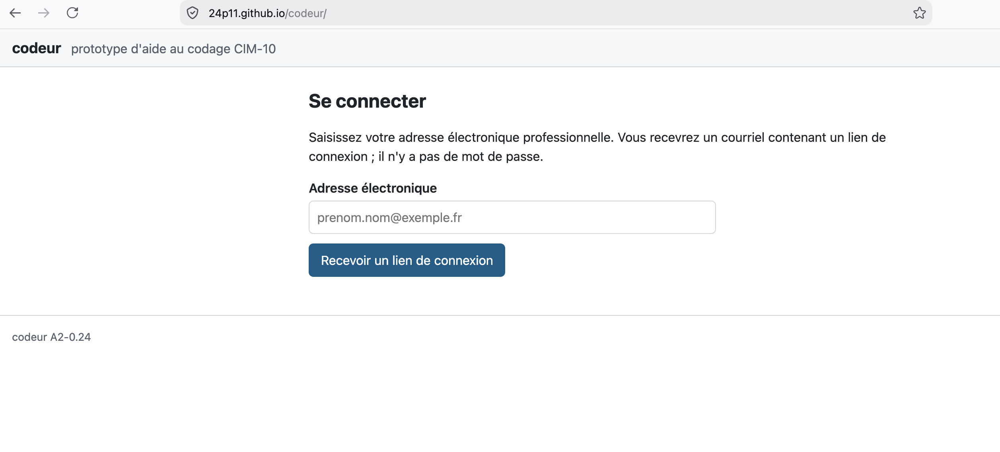
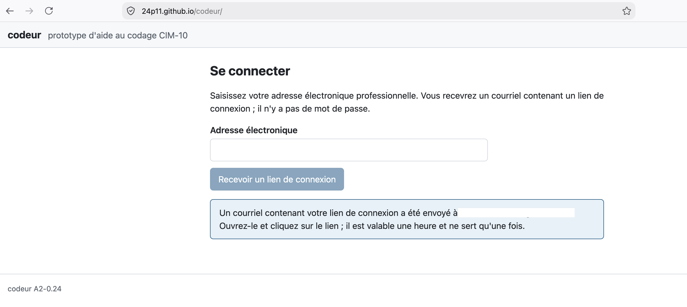
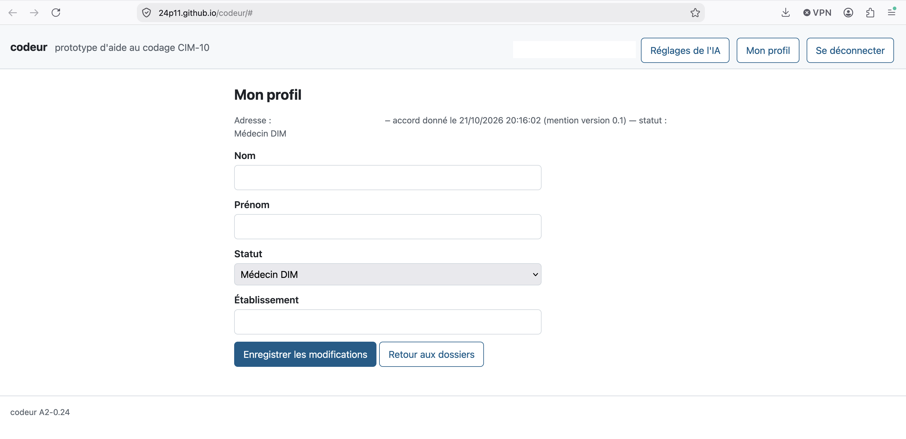
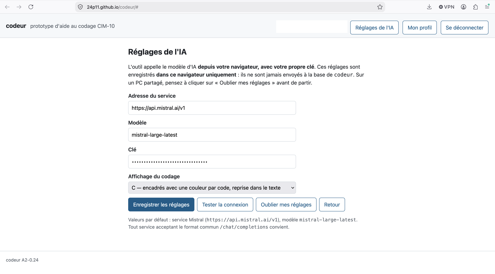
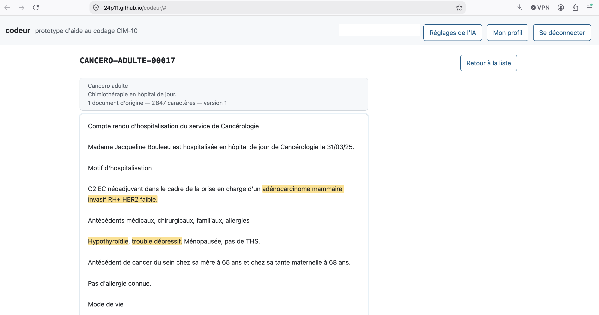
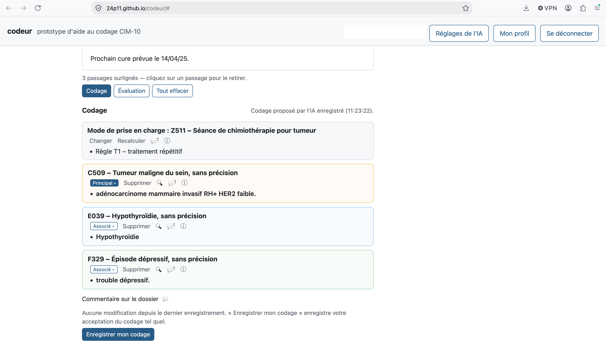
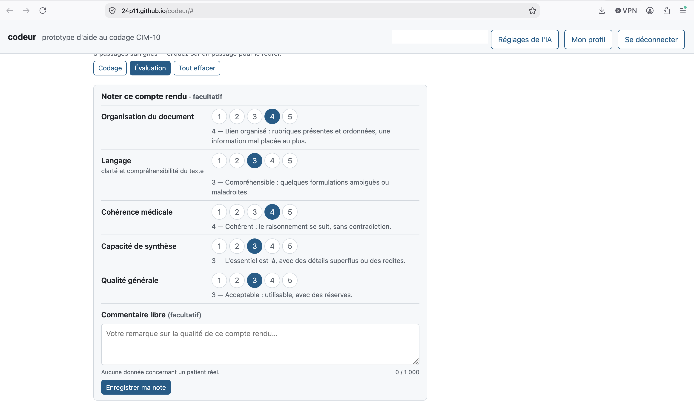

# Guide du testeur — `codeur`

*Version 0.1 — octobre 2026. Ce guide accompagne le prototype de codage CIM-10 assisté par l'IA : `https://24p11.github.io/codeur/`. Il est destiné aux testeurs. Les captures d'écran sont dans `docs/images/` ; trois emplacements restent à illustrer (mention d'information, liste des dossiers, un code avec ses icônes).*

---

## 1. De quoi s'agit-il ?

`codeur` est un **prototype de recherche**. Il sert à tester une idée simple : un codeur surligne dans un compte rendu les passages qui lui semblent utiles, et une intelligence artificielle (un « LLM ») propose les codes CIM-10 correspondants, puis la règle de hiérarchisation et le mode de prise en charge. Le codeur garde la main : il accepte, corrige, complète, et c'est son codage qui est enregistré.

Ce que nous cherchons à mesurer :

- l'IA regroupe-t-elle correctement les passages qui parlent d'une même affection ?
- trouve-t-elle les bons codes, au bon niveau de précision ?
- choisit-elle la bonne règle du guide des situations cliniques ?
- combien de corrections lui faut-il, et où se trompe-t-elle ?

**Les comptes rendus sont fictifs.** Il y en a deux sortes : ceux du corpus public PARHAF, rédigés par des médecins, et des comptes rendus générés par une IA à partir de scénarios de séjours. Aucun ne concerne un patient réel. **N'introduisez jamais de données concernant un patient réel**, ni dans les commentaires, ni ailleurs.

Tout ce que vous faites dans l'outil est enregistré : vos codages à chaque étape, vos commentaires, vos notes, et les échanges avec l'IA. C'est ce qui nous permet d'analyser l'aide au codage. Les résultats publiés ne contiendront ni votre nom ni votre adresse.

## 2. Ce qu'il vous faut

1. **Un navigateur récent** (Firefox, Chrome, Edge), sur PC ou Mac. Rien à installer.
2. **Une adresse électronique** : la connexion se fait par un lien envoyé par courriel, sans mot de passe.
3. **Une clé d'accès à un modèle d'IA.** Par défaut, l'outil utilise Mistral (`mistral-large-latest`). La clé est personnelle : elle reste dans votre navigateur et n'est jamais transmise à l'outil. Les appels sont faits avec votre propre compte, sous les conditions du fournisseur. `[À COMPLÉTER : comment obtenir une clé Mistral, ou qui contacter pour en recevoir une]`

Sur un **PC partagé**, pensez à utiliser le bouton « Oublier mes réglages » en partant (§ 11) : il efface votre clé du navigateur.

## 3. Première connexion et inscription

1. Ouvrez `https://24p11.github.io/codeur/`.
2. Saisissez votre adresse électronique et cliquez sur **« Recevoir un lien de connexion »**.

   

3. Ouvrez le courriel reçu et cliquez sur le lien : vous arrivez connecté dans l'outil. Le lien n'est valable qu'un temps limité ; s'il a expiré, demandez-en un nouveau.

   
4. À la première connexion, l'outil affiche la **mention d'information**. Lisez-la, puis cochez les deux cases : l'engagement à n'introduire aucune donnée concernant un patient réel, et l'accord pour l'utilisation de votre travail à des fins de recherche ; puis **« Continuer vers la fiche d'inscription »**.

   <!-- [Capture : mention et cases à cocher] — image à fournir -->

5. Remplissez la **fiche d'inscription** : nom, prénom, statut (médecin DIM, TIM, autre médecin, interne, étudiant, autre), établissement ; puis **« Enregistrer et commencer »**. Vous pourrez modifier ces informations plus tard par **« Mon profil »**, en haut de la page.

   

Aux connexions suivantes, vous arrivez directement sur la liste des dossiers. Si la mention d'information change, l'outil vous la représentera.

**Si le courriel n'arrive pas** : vérifiez vos indésirables ; sinon, écrivez à `[À COMPLÉTER : adresse de contact]`, qui pourra vous envoyer un lien directement.

## 4. Régler l'accès à l'IA

Avant le premier codage, ouvrez **« Réglages de l'IA »** (en haut de la page) :

- **Adresse du service** : laissez la valeur proposée (`https://api.mistral.ai/v1`), sauf consigne contraire.
- **Modèle** : laissez `mistral-large-latest`.
- **Clé** : collez votre clé.
- Cliquez sur **« Tester la connexion »** : l'outil envoie une courte demande au service et vous dit si la réponse arrive.
- Cliquez sur **« Enregistrer les réglages »** pour les conserver.

Ces réglages sont enregistrés dans votre navigateur, sur cet ordinateur seulement. Sur un autre poste, il faudra les saisir de nouveau.

Vous y trouverez aussi le **choix de l'affichage du codage** (§ 8) et le bouton **« Oublier mes réglages »**. Le bouton **« Aide »**, en haut de la page, ouvre ce guide.

## 5. Choisir un dossier

La liste présente les dossiers disponibles, par pages.

<!-- [Capture : liste des dossiers] — image à fournir -->

- **Source** : PARHAF (comptes rendus rédigés par des médecins, souvent plusieurs documents mis bout à bout : consultation, compte rendu opératoire, hospitalisation) ou CRH synthétiques (générés par une IA, un document par séjour).
- **Spécialité** et **type de prise en charge** : pour filtrer.
- **Identifiant** : pour retrouver un dossier précis (les huit premiers caractères suffisent).

Cliquez sur **« Ouvrir »** au bout de la ligne pour ouvrir un dossier. Vous pouvez revenir à la liste à tout moment (« Retour à la liste ») ; votre travail en cours est conservé dans le navigateur.

## 6. Surligner

Le texte du compte rendu s'affiche tel quel, en largeur de lecture. Les documents d'origine de PARHAF sont séparés par des intitulés (« — Consultation — », « — Compte rendu opératoire — »…).

- **Pour surligner** : sélectionnez un passage à la souris, comme dans un traitement de texte. Il est surligné dès que vous relâchez le bouton.
- **Pour retirer un surlignage** : cliquez dessus.
- **« Tout effacer »** retire tous les surlignages (et le codage en cours, après confirmation).
- Vos surlignages sont conservés si vous fermez la page et revenez plus tard, sur le même ordinateur.

**Que surligner ?** Tout ce que vous voudriez voir codé : la mention d'une affection, mais aussi ce qui l'étaye ou la précise (un résultat d'examen, un traitement, un geste). Vous n'avez pas à regrouper les passages : c'est l'IA qui le fera. Un passage surligné est un passage à coder ; si l'IA estime qu'aucun code ne lui correspond, elle le dira, et vous pourrez le coder vous-même.

## 7. Faire coder par l'IA

Cliquez sur **« Codage »**, sous le texte. L'outil fait alors deux choses, l'une après l'autre :

1. **Les codes.** L'IA regroupe vos passages par affection et propose un code pour chaque groupe. L'outil vérifie chaque code dans l'index officiel de la CIM-10 (version PMSI). Si l'IA propose un code qui n'existe pas ou n'est pas utilisable en MCO, l'outil lui demande de choisir parmi les codes valides ; si elle n'y parvient pas, le code vous est laissé « à choisir ».
2. **La règle et le mode de prise en charge.** À partir de la pathologie principale, l'outil sélectionne les règles du guide des situations cliniques qui peuvent s'appliquer, et donne à l'IA les extraits officiels du guide méthodologique MCO qui les définissent. L'IA choisit la règle et le mode de prise en charge (« DP » quand la pathologie principale motive elle-même le séjour, ou un code Z).

Comptez quelques secondes pour le premier appel et une dizaine pour le second ; le pavé affiche « calcul en cours… » entre les deux.

**Vous pouvez recliquer sur « Codage » autant de fois que vous voulez.** Si vous ajoutez des surlignages, seuls les nouveaux passages sont envoyés à l'IA : les codes déjà présents, les vôtres comme les siens, sont conservés. S'il n'y a rien de nouveau, l'outil vous le dit et n'appelle pas l'IA.

## 8. Lire et corriger le codage

Le codage s'affiche sous le texte. En tête, le **mode de prise en charge** et la **règle** ; puis la **pathologie principale** et les **diagnostics associés**, chacun avec la liste de ses éléments de preuve (les passages surlignés). Les preuves **directes**, qui nomment l'affection, sont en gras ; les preuves **indirectes**, qui l'étayent (un examen, un traitement), en texte normal.

<!-- [Capture : un code avec ses icônes et ses preuves] — image à fournir -->

Sous chaque code, une ligne de boutons et d'icônes, dans cet ordre :

| Bouton ou icône | Action |
|---|---|
| **Principal ▾** / **Associé ▾** | Cliquez pour changer la catégorie. Il n'y a qu'une pathologie principale : en désigner une autre fait passer la précédente en diagnostic associé |
| **Supprimer** | Supprimer le code. Ses passages restent surlignés ; au prochain « Codage », l'IA est prévenue que vous avez rejeté ce code |
| 🔍 | Changer le code : tapez un début de code (`K40`) ou des morceaux de mots (`hernie ing`, `fract tum`). Seuls les codes utilisables sont proposés, avec leur libellé officiel |
| 💬 | Lire ou écrire des commentaires sur ce code (§ 9). Le nombre en exposant indique combien il y en a |
| ⚠ | L'IA a proposé un code qui n'est pas utilisable : le code est « à choisir » (lisez le détail au survol, puis 🔍) |
| ◎ | Un code plus précis existe : 🔍 vous proposera directement ses subdivisions |
| ◌ | Le code n'a plus de preuve : gardez-le ou supprimez-le |
| ⚑ | L'IA a ajouté un passage aux preuves de ce code lors d'un appel suivant |
| ↺ | L'IA a reproposé un code que vous aviez rejeté |
| ≡ | Un même passage est cité par plus de deux codes |
| ⓘ | La confiance que l'IA donne à ce code (au survol) ; son explication est dans les commentaires (💬) |

**Les preuves** :

- **retirer** une preuve : la croix ✕ qui apparaît au survol de la preuve ;
- **ajouter** une preuve : sélectionnez un passage dans le texte, un petit menu propose « Ajouter à [code] » pour chacun des codes, « Nouveau code… » (ouvre la recherche de code), ou « Surligner seulement (pour un prochain codage) » ;
- **déplacer** une preuve d'un code à un autre : glissez-la sur l'autre code, ou cliquez sur ⋯ (au survol de la preuve) puis « Déplacer vers… ».

**Le mode de prise en charge et la règle**, en tête du pavé, présentés comme un code : « Mode de prise en charge : [code] – [libellé] », puis une ligne de boutons et d'icônes, puis « • Règle … ». **« Changer »** ouvre la liste des règles compatibles avec la pathologie principale (puis « Toutes les règles ») et la liste des modes possibles pour la règle choisie. **« Recalculer »** ouvre un commentaire facultatif pour guider l'IA (« séjour programmé pour la seconde cure ») et le bouton « Recalculer la règle ». 💬 donne les commentaires et l'explication de l'IA ; ⓘ sa confiance. Deux alertes ⚠ peuvent apparaître ici, à lire au survol : « règle à revoir » si vous avez changé la pathologie principale depuis le calcul, et « pathologie principale à revoir : ne peut pas être DR » si l'IA estime qu'avec le code Z retenu, la pathologie principale ne peut pas être le diagnostic relié.

**Les passages non codés** : en bas du pavé, les passages que l'IA a examinés sans leur attribuer de code, avec sa raison. Si vous n'êtes pas d'accord, « Coder ce passage » ouvre la recherche de code.

**Enregistrer.** Vos corrections restent dans le navigateur jusqu'à ce que vous cliquiez sur **« Enregistrer mon codage »**. Enregistrez aussi quand vous acceptez le codage tel quel : c'est une information utile (« le codeur a relu et n'a rien changé »). Vous pouvez enregistrer plusieurs fois : chaque enregistrement est une nouvelle version, rien n'est perdu.

**Trois affichages** sont proposés dans « Réglages de l'IA », liste « Affichage du codage » : A, liste simple ; B, encadrés ; C, une couleur par code reprise dans le surlignage du texte (le réglage par défaut). Essayez-les et dites-nous lequel vous convient.

## 9. Commenter

Les commentaires servent à tout ce qui mérite une explication ou une discussion :

- **sur un code** (💬 sous le code) : pourquoi vous l'avez changé, un doute, une remarque pour l'équipe ;
- **sur le dossier** (zone « Commentaire sur le dossier », sous le codage).

Les commentaires s'affichent dans la marge de droite (sous le code sur un petit écran). Vous y trouverez aussi les **explications de l'IA** (pourquoi elle a proposé tel code ou telle règle) et les **alertes de l'outil**. Un commentaire que vous venez d'écrire est marqué « non enregistré » : vous pouvez le modifier (✎) ou le supprimer (✕) jusqu'à « Enregistrer mon codage », qui l'enregistre avec le codage. Un commentaire enregistré se retire avec « retirer » ; ceux de l'IA et de l'outil ne se retirent pas.

Rappel : **aucune donnée concernant un patient réel** dans les commentaires.

## 10. Noter le compte rendu

Le bouton **« Évaluation »** ouvre une grille de notation du compte rendu lui-même, sur cinq dimensions notées de 1 à 5 : organisation du document, langage, cohérence médicale, capacité de synthèse, qualité générale. Un court repère explique chaque niveau.

La notation est **facultative** et indépendante du codage : « Enregistrer ma note ». Elle nous aide à comprendre si la qualité du texte influence le codage, par l'IA comme par vous. Un second clic sur « Évaluation » ramène au codage.

## 11. Terminer, reprendre, se déconnecter

- **Reprendre un dossier** : rouvrez-le depuis la liste ; votre dernier codage enregistré s'affiche, avec vos modifications non enregistrées si vous êtes sur le même ordinateur.
- **Se déconnecter** : bouton en haut de page.
- **Sur un PC partagé** : « Réglages de l'IA » → **« Oublier mes réglages »** efface votre clé d'IA du navigateur.

## 12. Si quelque chose ne va pas

| Ce que vous voyez | Ce que cela veut dire |
|---|---|
| « Les valeurs de recherche n'ont pas pu être chargées », ou la liste reste vide | La base n'est pas joignable (réseau, pare-feu). Réessayez ; si cela persiste depuis votre établissement, signalez-le-nous : c'est une information utile |
| « Tester la connexion » échoue | La clé est incorrecte, ou le service d'IA n'est pas joignable depuis votre réseau. Vérifiez la clé ; sinon, signalez-le-nous |
| Le codage ne vient pas, ou un message d'erreur de l'IA | Réessayez une fois ; si cela persiste, notez l'heure et le dossier et signalez-le-nous |
| Un code « à choisir » | L'IA n'a pas trouvé de code valide : cliquez sur 🔍 pour choisir vous-même |
| Un passage que vous vouliez coder est « non codé » | Cliquez sur « Coder ce passage » |
| Le surlignage ne se place pas où vous voulez | Essayez une sélection plus courte ; signalez-nous le dossier et le passage si cela se reproduit |

Pour tout signalement ou question : `[À COMPLÉTER : adresse de contact]`. Dites-nous le dossier (son identifiant est en haut de la page) et, si possible, ce que vous avez fait juste avant.

## 13. Ce que nous ferons de votre travail

Vos codages seront comparés au codage de référence de chaque dossier, aux propositions de l'IA et aux codages des autres testeurs. Nous mesurerons la qualité des propositions, les corrections nécessaires et l'accord entre codeurs. Les jeux de données constitués pour améliorer les modèles ne contiendront ni votre nom ni votre adresse. Vous pouvez à tout moment demander la consultation ou la suppression de vos données (voir la mention d'information).

Merci de votre participation.
